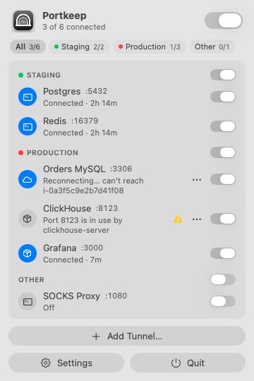
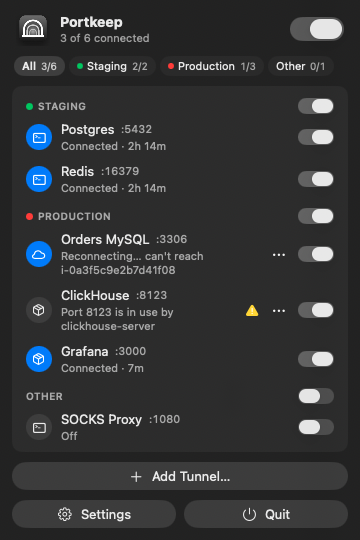
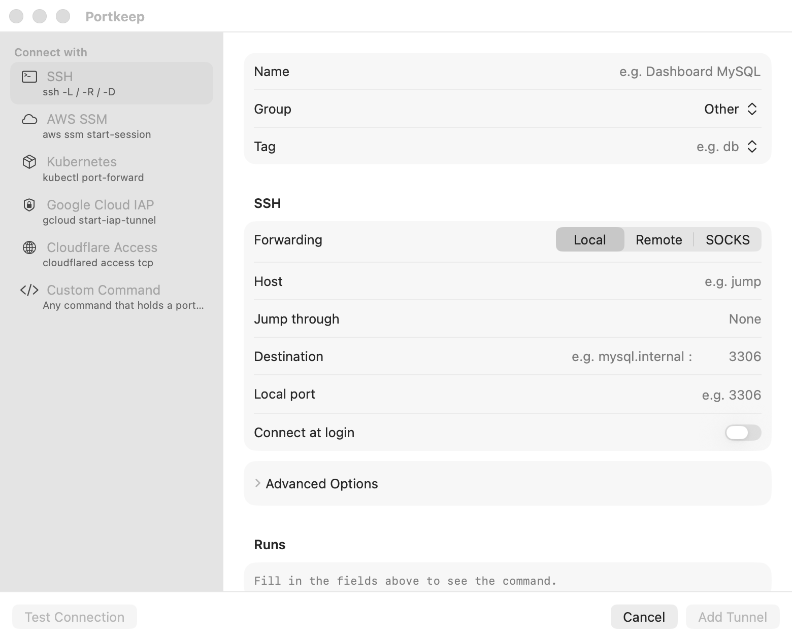
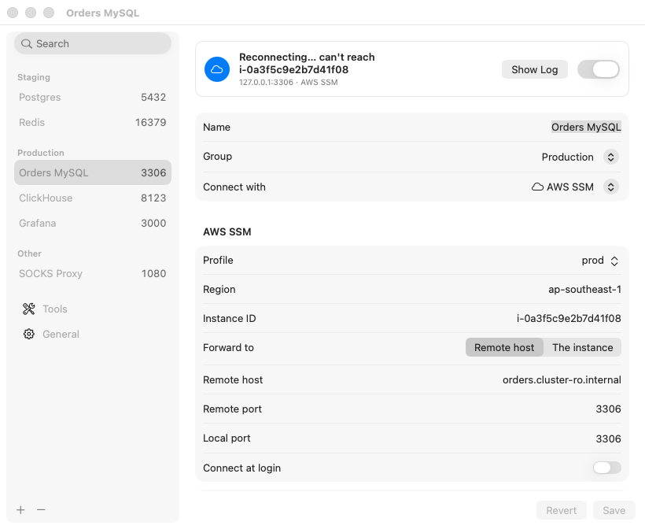
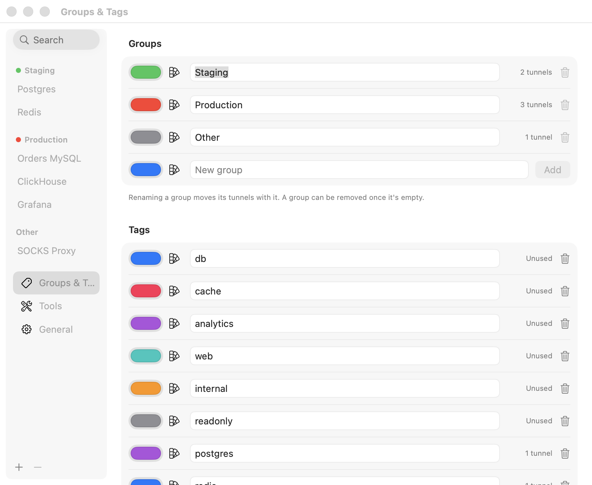
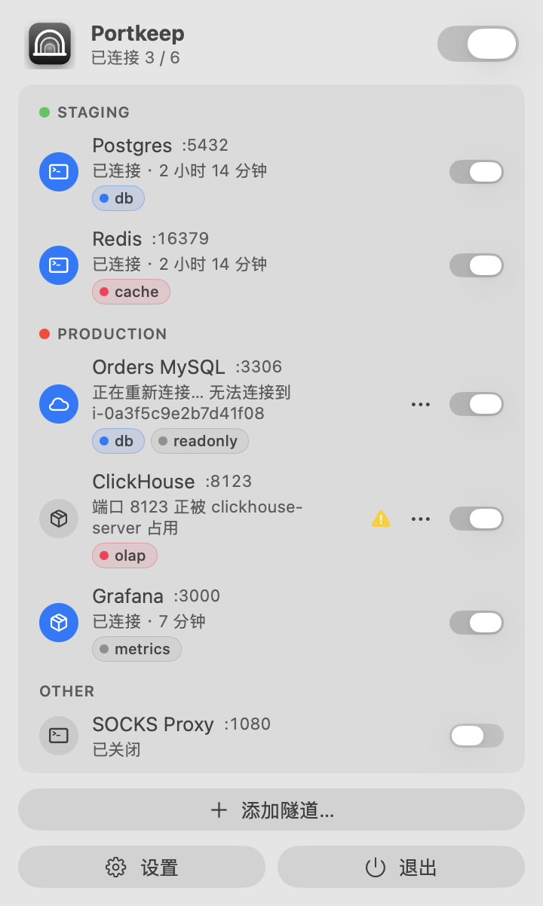
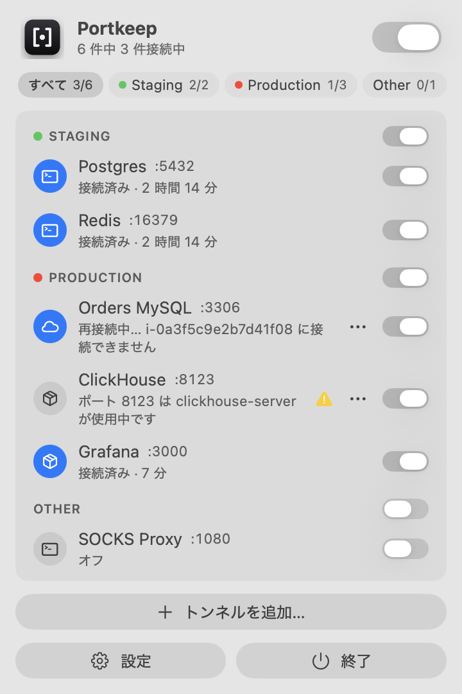

<p align="center">
  
</p>

<h1 align="center">Portkeep</h1>

<p align="center"><strong>Keep your port forwards up, from the menu bar.</strong></p>

Portkeep is a macOS menu bar app for the tunnels you open every day: databases, caches, dashboards and SOCKS proxies behind SSH jump hosts, AWS Session Manager, Kubernetes and more. Name each tunnel once and switch it on when you need it. Portkeep keeps it alive. When a tunnel drops, Portkeep says which one, why, and that it is already reconnecting.

[ภาษาไทย](README.th.md)

<p align="center">
  
  &nbsp;&nbsp;
  
</p>

## Why

A terminal tab running `ssh -N -L 5432:db:5432 bastion` works until the laptop sleeps, the Wi-Fi changes or the session times out. Then your database client is the first to find out. Portkeep replaces those tabs:

- **A switch per tunnel.** Each tunnel sits under a group (Production, Development, …) with its local port, live status and a tag.
- **Honest status.** A tunnel shows *Connected* only when its local port actually accepts connections; a running process isn't enough.
- **Automatic reconnect.** It reconnects after sleep, a network change or a dropped session. Retries back off from 1 s to 60 s, and no retries are spent while you're offline.
- **It remembers.** Tunnels that were on when Portkeep quit come back on at the next launch, including after a restart.
- **Failures explain themselves.**
  - "Host key changed for bastion"
  - "AWS sign-in expired for profile prod"
  - "Port 8123 is in use by clickhouse-server"

  Each comes with the fix one click away.
- **Notifications.** When a tunnel has been down for 30 seconds or needs you (an expired sign-in, a changed host key, a taken port), macOS tells you once, and again when it's back.
- **No port clashes.** Portkeep checks the port before starting, names the process holding it, and offers a free one.
- **On demand.** Set a tunnel to *Start when an app connects* (Advanced Options) and Portkeep holds the port itself, shows *Standing by*, and opens the real tunnel the moment your client connects. It stops again after 10 idle minutes (or never, with 0). Works for local and SOCKS forwards and for custom commands that use `{port}`.
- **One switch per port.** Tunnels may share a local port, such as Production and Development MySQL both on 3306. Switching one on switches the other off first, so changing environment is one click and your client keeps the same address.

## Connection methods

| Method | Runs | You need |
|---|---|---|
| SSH (local `-L`, remote `-R`, SOCKS `-D`, ProxyJump) | `ssh` | Keys in your agent or keychain, hosts in `~/.ssh/config` |
| AWS Session Manager (to a remote host through an instance, or to the instance) | `aws ssm start-session` | AWS CLI + `session-manager-plugin`; SSO profiles sign in when they expire |
| Kubernetes (service, deployment or pod) | `kubectl port-forward` | `kubectl` and a kubeconfig context |
| Google Cloud IAP | `gcloud compute start-iap-tunnel` | `gcloud`, signed in |
| Cloudflare Access | `cloudflared access tcp` | `cloudflared` |
| Custom command | anything that holds a port open (`{port}` is replaced) | — |

Portkeep drives the tools you already use, with your existing config and credentials, and shows the exact command it runs. It never stores passwords, keys or tokens.

<p align="center">
  
</p>

## Install

Requires macOS 14 Sonoma or later (Apple silicon or Intel).

**Homebrew** (recommended):

```
brew install --cask rattamnoon/tap/portkeep
```

Update with `brew upgrade --cask portkeep`.

**Download.** Get `Portkeep-<version>.dmg` from [Releases](https://github.com/rattamnoon/portkeep/releases), open it and drag Portkeep to Applications.

Releases aren't notarized yet, so the first time macOS may say it can't check the app. Right-click Portkeep in Applications and choose **Open**, or run `xattr -dr com.apple.quarantine /Applications/Portkeep.app`.

**Build from source**

```
brew install xcodegen
git clone https://github.com/rattamnoon/portkeep.git && cd portkeep
xcodegen generate
xcodebuild -scheme Portkeep -configuration Release -derivedDataPath build build
ditto build/Build/Products/Release/Portkeep.app /Applications/Portkeep.app
open /Applications/Portkeep.app
```

Install the CLIs for the methods you use, for example `brew install awscli kubectl cloudflared` and `brew install --cask session-manager-plugin google-cloud-sdk`.

## Use

1. Click the tunnel icon in the menu bar, then **Add Tunnel…**
2. Pick a method and fill in the fields. Hosts from `~/.ssh/config`, AWS profiles and kube contexts you already have are offered in pickers.
3. Choose a local port, a group and a tag (one per tunnel). The **Runs** box shows the exact command.
4. Press **Test Connection** to check it, then **Add Tunnel**.
5. Use a tunnel's switch in the menu to start or stop it. Each group header has a switch for the whole group, and the switch at the top starts or stops them all. With more than one group, tabs under the header show **All** or a single group, each with its connected count; the menu remembers the last one. Tunnels sharing a port aren't started together: the first one in the list wins.

When a tunnel needs you, the menu bar icon shows a dot and the row shows a warning. Open **⋯** on the row for:
- the fix (use another port, sign in to AWS, retry);
- **Change Local Port…**, **Copy Address**, **Edit Tunnel…**, **Duplicate** or **Show Log**.

**Duplicate** copies a tunnel, settings and all, as "<name> copy" (switched off) and opens it in Settings: the quick way to add Development next to Production.

If the icon is hidden under the notch, open Portkeep again from Finder or Spotlight and the Settings window comes up.

<p align="center">
  
</p>

**Settings** lists every tunnel by group, with search over names, ports, groups and tags. Pick a tunnel to see its live status, **Start**/**Stop** it, edit it, or open its log. Right-click a group header for **Start All** and **Stop All**, or a tunnel for **Duplicate**. Editing the name, group or tags of a running tunnel doesn't restart it.

### Groups, tags and colours

Portkeep starts with five groups and six tags, each with a colour:
- **Groups:** Production, Staging, Development, Local, Other
- **Tags:** db, cache, analytics, web, internal, readonly

In **Settings › Groups & Tags** you can:
- add a group or tag with any colour (system colour picker or presets);
- rename one, and its tunnels follow;
- remove one. A group must be empty first; removing a tag takes it off its tunnels.

When editing a tunnel, type a new group or tag right in the form.

<p align="center">
  
</p>

### Tools and General

- **Tools** shows where each CLI was found on your login shell's `PATH`, with a ✓ or ⚠. Type a path or use **Choose…** to use a different binary; **Reset** goes back to the one found.
- **General** sets the language, whether Portkeep reopens the tunnels that were on when it quit (on by default), and whether it notifies you when a tunnel drops (on by default; macOS asks for permission the first time). Tunnels set to **Connect at login** always start, and Portkeep adds itself as a login item while any tunnel uses that setting.

### Command line and URLs

**Settings › General › Install Command Line Tool…** links `portkeep` into `/usr/local/bin` when it can write there, otherwise `~/.local/bin` (and tells you if that isn't on your `PATH`). If neither works it shows the `sudo ln -s` line to paste.

```
portkeep list                        # name, group, port, state
portkeep status "Orders MySQL"       # exits 0 when connected
portkeep start "Orders MySQL"        # also stop, toggle
portkeep start-group Development     # also stop-group, start-all, stop-all
portkeep open                        # Settings
```

Names and groups match ignoring case. Changes go to Portkeep in the background, launching it if needed; `list` and `status` read `status.json`. The same commands work as URLs from anywhere that opens links (Shortcuts, Raycast, a script's `open`):

```
portkeep://start?name=Orders%20MySQL
portkeep://stop?group=Production
portkeep://toggle?all
portkeep://open?name=Redis
```

`name` also takes a tunnel's id from `tunnels.json`.

## Languages

English, ไทย, 简体中文 and 日本語. Portkeep follows your macOS language. To change it, use **Settings › General › Language** (Portkeep relaunches) or set it per app in **System Settings › General › Language & Region**.

<p align="center">
  
  
  
</p>

## Where things live

All in `~/Library/Application Support/Portkeep/`:

| File | What |
|---|---|
| `tunnels.json` | Tunnels, groups, tags, colours and tool paths. Plain JSON, safe to back up or edit while Portkeep is quit. |
| `session.json` | Which tunnels are switched on, to reopen them at the next launch. |
| `running.json` | Child processes, so they can be stopped after a crash. |
| `status.json` | What each tunnel is doing right now, for the `portkeep` command. Written by the app, never read back. |

If `tunnels.json` can't be read, Portkeep moves it aside to `tunnels.json.broken-<date>` instead of overwriting it.

## Limits in this version

- Authentication must already work without typing; passwords, passphrase prompts and OTP aren't supported yet. Add passphrase keys with `ssh-add --apple-use-keychain`.
- There is no sync between Macs, import/export or native Shortcuts actions yet; a shortcut can open a `portkeep://` URL.
- Builds from source are ad-hoc signed. Until notarized releases are published, macOS warns when you open a copy on another Mac.
- Portkeep is not on the Mac App Store, because the sandbox would stop it running your CLIs and reading your config.

## Development

```
swift test                                   # TunnelKit unit tests
xcodegen generate                            # Portkeep.xcodeproj (not committed)
xcodebuild test -scheme Portkeep -destination 'platform=macOS'   # UI smoke tests
swift scripts/make-icon.swift                # redraw the app icon
```

UI smoke tests drive real windows, so run them on a Mac you aren't using or rely on CI. For demo data and screenshots, run `PORTKEEP_DEMO=1 PORTKEEP_SHOW=menu,settings,add,labels PORTKEEP_DATA_DIR=$(mktemp -d) Portkeep.app/Contents/MacOS/Portkeep`.

### Releases

To cut a release, push a tag (`git tag v0.2.0 && git push origin v0.2.0`) or run **Actions › Release › Run workflow** with a version.
- The [Release workflow](.github/workflows/release.yml) builds `Portkeep-<version>.dmg`, creates the tag if needed, and publishes a GitHub Release with notes and a SHA-256.
- It signs and notarizes when the Developer ID secrets listed at the top of the workflow are set. Otherwise it publishes an unsigned build, labelled as such.
- To build locally: `scripts/release.sh <version>`, or `UNSIGNED=1 scripts/release.sh <version>`.

## License

[MIT](LICENSE) © 2026 Rattamnoon Kiratipisut
