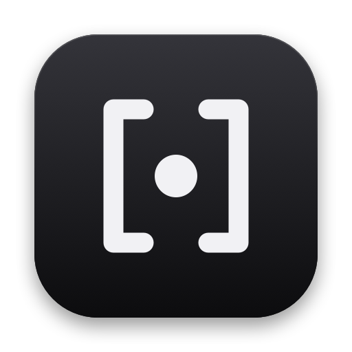
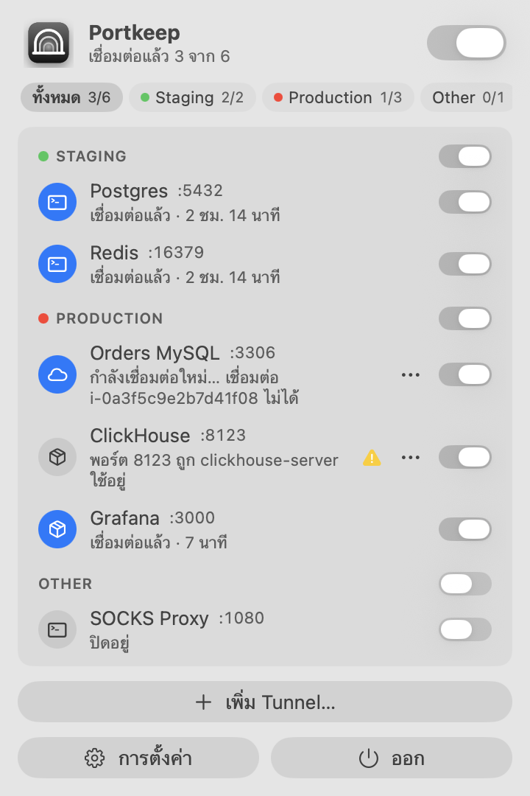
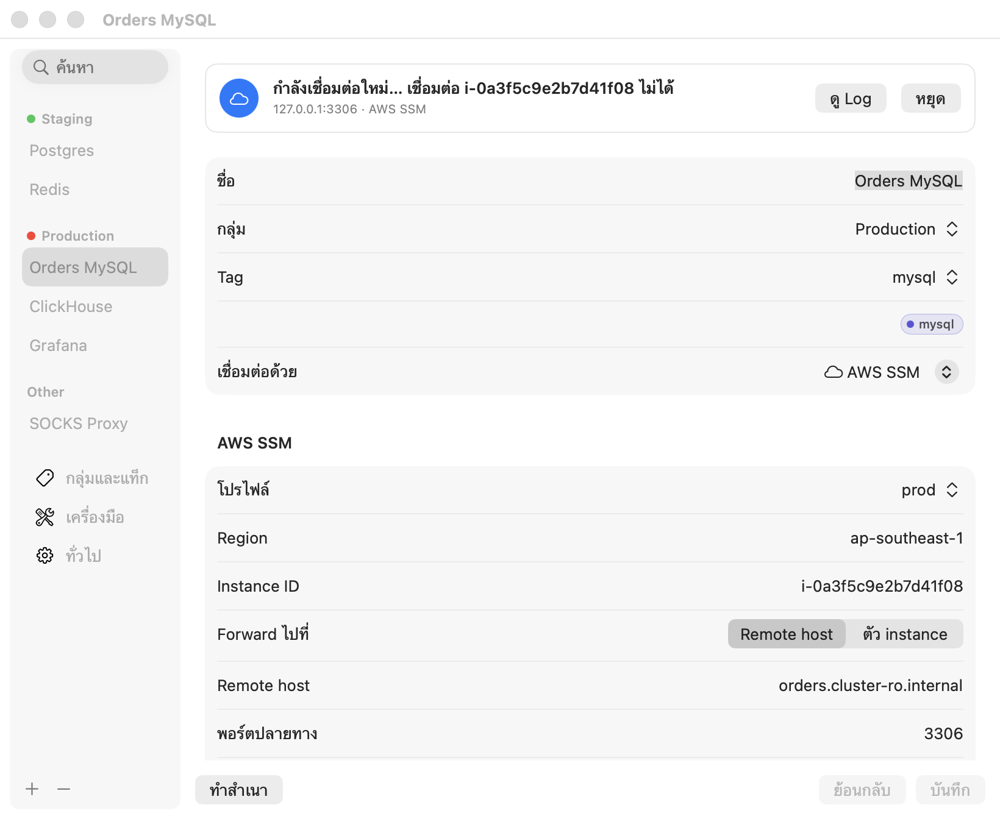

<p align="center">
  
</p>

<h1 align="center">Portkeep</h1>

<p align="center"><strong>เปิด port forward ค้างไว้ได้ตลอด จาก menu bar</strong></p>

Portkeep เป็นแอป menu bar บน macOS สำหรับ tunnel ที่ต้องเปิดใช้ทุกวัน เช่น ฐานข้อมูล, cache, dashboard หรือ SOCKS proxy ที่อยู่หลัง SSH jump host, AWS Session Manager, Kubernetes และอื่น ๆ ตั้งชื่อ tunnel ไว้ครั้งเดียว แล้วกดเปิดเมื่อต้องใช้ Portkeep จะดูแลให้ต่ออยู่ตลอด ถ้าหลุดจะบอกว่าตัวไหน เพราะอะไร และกำลังต่อใหม่ให้อยู่

[English](README.md)

<p align="center">
  
  &nbsp;&nbsp;
  
</p>

## ทำอะไรได้

- **สวิตช์ประจำทุก tunnel**: จัดตามกลุ่ม (Production, Development …) แต่ละตัวแสดงพอร์ตในเครื่อง สถานะ และแท็ก (ตัวละหนึ่งแท็ก)
- **สถานะตรงความจริง**: ขึ้นว่าเชื่อมต่อแล้วก็ต่อเมื่อพอร์ตในเครื่องรับการเชื่อมต่อได้จริง ไม่ใช่แค่ process ยังรันอยู่
- **ต่อใหม่อัตโนมัติ**: หลังเครื่องหลับ, เปลี่ยน Wi-Fi หรือ session หลุด รอก่อนต่อใหม่ตั้งแต่ 1 วินาทีไล่ไปถึง 60 วินาที และไม่นับรอบตอนออฟไลน์
- **จำได้ว่าเปิดอะไรไว้**: ปิดแอปตอนที่ tunnel ไหนเปิดอยู่ ครั้งหน้าจะเปิดตัวนั้นให้เอง รวมถึงหลังรีสตาร์ทเครื่อง
- **บอกสาเหตุชัด ๆ**: เช่น host key เปลี่ยน, AWS SSO หมดอายุ, พอร์ตถูกโปรแกรมอื่นใช้อยู่ พร้อมปุ่มแก้ในคลิกเดียว
- **กันพอร์ตชน**: เช็กพอร์ตก่อนเริ่ม บอกชื่อโปรแกรมที่จองพอร์ตไว้ และเสนอพอร์ตที่ว่างให้
- **สลับ environment ด้วยพอร์ตเดียว**: หลาย tunnel ใช้พอร์ตในเครื่องร่วมกันได้ เช่น MySQL ของ Production และ Development ที่ 3306 ทั้งคู่ เปิดตัวหนึ่งแล้วตัวที่ใช้พอร์ตเดียวกันจะปิดให้ก่อน โปรแกรมฝั่งเราจึงต่อที่อยู่เดิมได้เลย

## วิธีเชื่อมต่อที่รองรับ

- SSH (`-L` / `-R` / `-D`, ProxyJump)
- AWS SSM `start-session`
- `kubectl port-forward`
- Google Cloud IAP
- Cloudflare Access
- คำสั่งที่กำหนดเอง ที่เปิดพอร์ตค้างไว้

Portkeep ใช้เครื่องมือที่คุณมีอยู่แล้วกับ config และ credential เดิม แสดงคำสั่งจริงที่จะรัน และไม่เก็บรหัสผ่าน คีย์ หรือ token ใด ๆ

## ติดตั้ง

ต้องใช้ macOS 14 Sonoma ขึ้นไป

- **Homebrew** (แนะนำ): `brew install --cask rattamnoon/tap/portkeep` อัปเดตด้วย `brew upgrade --cask portkeep`
- **ดาวน์โหลด**: ไฟล์ `Portkeep-<version>.dmg` ที่หน้า [Releases](https://github.com/rattamnoon/portkeep/releases) เปิดแล้วลากไปไว้ใน Applications
- release ยังไม่ได้ notarize ครั้งแรก macOS อาจเตือนว่าตรวจแอปไม่ได้ ให้คลิกขวาที่ Portkeep ใน Applications แล้วเลือก **Open** หรือรัน `xattr -dr com.apple.quarantine /Applications/Portkeep.app`
- **Build เอง**:

```
brew install xcodegen
git clone https://github.com/rattamnoon/portkeep.git && cd portkeep
xcodegen generate
xcodebuild -scheme Portkeep -configuration Release -derivedDataPath build build
ditto build/Build/Products/Release/Portkeep.app /Applications/Portkeep.app
open /Applications/Portkeep.app
```

## วิธีใช้

1. คลิกไอคอนอุโมงค์บน menu bar แล้วเลือก **เพิ่ม Tunnel…**
2. เลือกวิธีเชื่อมต่อ แล้วกรอกข้อมูล host, โปรไฟล์ AWS และ kube context ที่มีอยู่แล้วจะขึ้นให้เลือก
3. ตั้งพอร์ตในเครื่อง กลุ่ม และแท็ก (หนึ่งแท็กต่อ tunnel)
4. กด **ทดสอบการเชื่อมต่อ** แล้วกด **เพิ่ม Tunnel**
5. ใช้สวิตช์ท้ายแถวในเมนูเพื่อเปิด/ปิดทีละตัว หัวกลุ่มแต่ละกลุ่มมีสวิตช์เปิด/ปิดทั้งกลุ่ม และสวิตช์ด้านบนสุดเปิด/ปิดทั้งหมด tunnel ที่ใช้พอร์ตเดียวกันจะไม่เปิดพร้อมกัน ตัวที่อยู่บนสุดในรายการจะได้พอร์ตไป

ปุ่ม **⋯** ท้ายแถวมีปุ่มแก้ปัญหา, **เปลี่ยนพอร์ตในเครื่อง…**, **คัดลอกที่อยู่**, **แก้ไข Tunnel…** และ **ดู Log**

ในหน้าต่างการตั้งค่า คลิกขวาที่หัวกลุ่มเพื่อ **เปิดทั้งหมด** หรือ **ปิดทั้งหมด**

ถ้าไอคอนถูกรอยบาก (notch) บังอยู่ ให้เปิด Portkeep ซ้ำจาก Finder หรือ Spotlight หน้าต่างการตั้งค่าจะขึ้นมาเอง

## กลุ่ม แท็ก และสี

มีกลุ่มเริ่มต้น Production, Staging, Development, Local, Other และแท็กเริ่มต้น db, cache, analytics, web, internal, readonly ทั้งหมดมีสีให้แล้ว

ที่ **การตั้งค่า › กลุ่มและแท็ก** ทำได้ดังนี้:
- เพิ่มกลุ่มหรือแท็กใหม่ และเลือกสีอะไรก็ได้
- เปลี่ยนชื่อ แล้ว tunnel ที่ใช้อยู่จะเปลี่ยนตาม
- ลบ (ลบกลุ่มได้เมื่อไม่มี tunnel เหลืออยู่ในกลุ่ม)

ตอนแก้ไข tunnel พิมพ์ชื่อกลุ่มหรือแท็กใหม่ในฟอร์มได้เลย

## การตั้งค่าอื่น

- **เครื่องมือ**: แสดง path ของแต่ละโปรแกรม พร้อมไอคอน ✓ หรือ ⚠ เลือกไฟล์อื่นด้วย **เลือก…** หรือกด **รีเซ็ต** เพื่อกลับไปใช้ตัวที่หาเจอ
- **ทั่วไป**: เปลี่ยนภาษา (อังกฤษ, ไทย, จีนตัวย่อ, ญี่ปุ่น) และเปิด/ปิดการเปิด tunnel ที่ค้างไว้ให้อีกครั้งเมื่อเปิดแอป

## ข้อจำกัดของเวอร์ชันนี้

- ยังไม่รองรับการพิมพ์รหัสผ่าน, passphrase หรือ OTP ให้เพิ่มคีย์เข้า agent ด้วย `ssh-add --apple-use-keychain` ก่อน
- ยังไม่มี sync ข้ามเครื่อง และ import/export
- build เองเป็นการเซ็นแบบ ad-hoc ถ้าคัดลอกไปเครื่องอื่น macOS จะเตือนก่อนเปิด จนกว่าจะมี release ที่ notarize แล้ว
- ไม่ขึ้น Mac App Store เพราะ sandbox ทำให้เรียกเครื่องมือและอ่าน config ของคุณไม่ได้

## License

[MIT](LICENSE) © 2026 Rattamnoon Kiratipisut ใช้ แก้ไข และแจกต่อได้อิสระ ขอแค่คงข้อความลิขสิทธิ์ไว้
