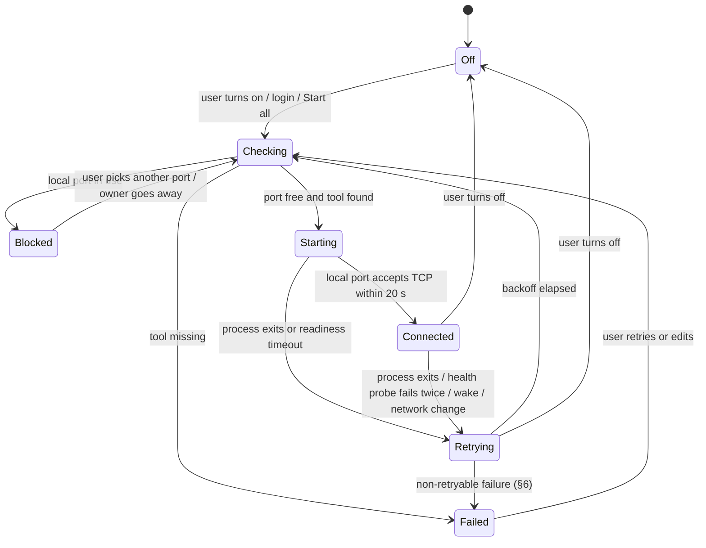

# Burrow — v1 Specification

Status: draft · 2026-10-17 · Product context: [PRODUCT.md](../PRODUCT.md) · Decisions: [adr/](adr/) · UI: [design canvas](https://claude.ai/artifact/QabMvafdQJC15Zn8NMYZe4) (page "Apple-style")

## 1. What it is

A macOS menu bar app that keeps named port forwards up. Each tunnel is started by the user's own CLI (`ssh`, `aws`, `kubectl`, `gcloud`, `cloudflared`, or any command), watched by probing its local port, and restarted when it drops. The app is called Burrow (repo `rattamnoon/burrow`, bundle id `com.rattamnoon.burrow`).

## 2. Scope

### In v1

- Menu bar item with a popover listing tunnels by group, each switchable on/off.
- Six connection methods (§4), each with an Add/Edit form and Advanced options.
- Automatic reconnect after process exit, sleep/wake, and network change.
- Port-conflict detection before start, naming the owning process, with a one-click alternate port.
- Readable failure reasons (§6) and a per-tunnel log.
- Import hosts from `~/.ssh/config`, profiles from `~/.aws/config`, contexts from kubeconfig.
- Connect selected tunnels at login.
- Signed, notarized `.dmg` and a Homebrew cask; in-app updates.

### Not in v1

- Password, OTP, or passphrase prompts (ADR-0006). Auth must already work non-interactively in Terminal.
- Sync between Macs, team sharing, import/export, Shortcuts/AppleScript.
- Mac App Store build (ADR-0001).
- Bandwidth/throughput metrics.

## 3. Platform

- macOS 14 Sonoma or later; Apple silicon and Intel (universal binary).
- Swift 6, SwiftUI `MenuBarExtra` with `.menuBarExtraStyle(.window)`; Settings via the `Settings` scene (ADR-0003).
- Not sandboxed; Developer ID signed, hardened runtime, notarized (ADR-0001).
- `LSUIElement = YES` (no Dock icon).

## 4. Connection methods

Each method turns a tunnel definition into an argv. `{L}` = local port, `{H}`/`{P}` = destination host/port. Advanced options append flags exactly as shown.

| Method | argv (v1) | Required tool |
|---|---|---|
| SSH local | `ssh -N -L {L}:{H}:{P} [-J jump] -o ExitOnForwardFailure=yes -o ServerAliveInterval={ka} -o BatchMode=yes <host>` | `ssh` |
| SSH remote | same with `-R {L}:{H}:{P}` (`{L}` = remote listen port; nothing to probe locally, see §5.3) | `ssh` |
| SSH SOCKS | `ssh -N -D {L} …same options… <host>` | `ssh` |
| AWS SSM → host | `aws ssm start-session --profile <p> --region <r> --target <instance-id> --document-name AWS-StartPortForwardingSessionToRemoteHost --parameters host={H},portNumber={P},localPortNumber={L}` | `aws`, `session-manager-plugin` |
| AWS SSM → instance | same with `--document-name AWS-StartPortForwardingSession --parameters portNumber={P},localPortNumber={L}` | `aws`, `session-manager-plugin` |
| Kubernetes | `kubectl --context <c> -n <ns> port-forward <kind>/<name> {L}:{P} --address 127.0.0.1` | `kubectl` |
| GCP IAP | `gcloud compute start-iap-tunnel <instance> {P} --local-host-port=localhost:{L} --zone <z> --project <proj>` | `gcloud` |
| Cloudflare | `cloudflared access tcp --hostname <hostname> --url localhost:{L}` | `cloudflared` |
| Custom | user string, `{port}` replaced by `{L}`, run as `/bin/zsh -c <string>` | — |

SSH Advanced: identity file (`-i`), keep-alive seconds (default 30), ExitOnForwardFailure (default on), compression (`-C`, default off), extra arguments (split shell-style and appended before `<host>`).

Tools are found on the PATH of the user's login shell, not the app's launch PATH (§5.6).

## 5. Behaviour

### 5.1 States



### 5.2 Reconnect

- Backoff after each failed attempt: 1, 2, 4, 8, 16, 30, 60 s, then 60 s forever. Reset to 1 s after 60 s continuously Connected.
- On wake from sleep and on network path change to `satisfied`: every tunnel that is on goes straight to Checking, skipping the remaining backoff.
- While the network path is `unsatisfied`, Retrying tunnels wait without counting attempts.
- Process stop: SIGTERM, then SIGKILL after 3 s. On app quit, all children are stopped before exit.

### 5.3 Readiness and health (ADR-0004)

- Ready = a TCP connect to `127.0.0.1:{L}` succeeds. Poll every 250 ms up to 20 s after launch.
- Health while Connected: TCP connect every 10 s; two consecutive failures → Retrying.
- SSH remote (`-R`): no local port; Ready = process alive 3 s after launch; health = process alive.

### 5.4 Port conflicts

- Before Starting, try to `bind` `127.0.0.1:{L}`. If it fails, find the owner with `lsof -nP -iTCP:{L} -sTCP:LISTEN -Fpcn` and show "Port {L} is in use by {command} (pid {pid})".
- Offer "Use Port {L'}" where `{L'}` is the first free port in `{L}+10000`, `{L}+10001`, … (cap at 65535, then the first free port ≥ 20000).
- Two tunnels with the same local port cannot both be on; the second shows Blocked naming the first tunnel.

### 5.5 Login

- Per-tunnel "Connect at login" flag. App registers as a login item via `SMAppService.mainApp` when any tunnel has it.

### 5.6 Tool lookup

- Run `$SHELL -l -c 'printf %s "$PATH"'` once at launch (timeout 5 s, fallback `/opt/homebrew/bin:/usr/local/bin:/usr/bin:/bin`). Resolve each tool against that PATH; user may override a tool's path in Settings.
- A missing tool puts the tunnel in Failed with "{tool} not found" and an install hint (`brew install awscli`, `brew install --cask session-manager-plugin`, `brew install kubectl`, `brew install --cask google-cloud-sdk`, `brew install cloudflared`).

## 6. Failure reasons

Classified from the last 50 stderr lines and exit status. First match wins.

| Reason | Pattern (case-insensitive) | Retry? | Shown as |
|---|---|---|---|
| hostKeyChanged | `REMOTE HOST IDENTIFICATION HAS CHANGED` | no | Host key changed for {host}. Check it, then remove the old key from known_hosts. |
| authFailed | `Permission denied (` | no | {host} refused the key. |
| ssoExpired | `Token has expired` · `SSO session associated with this profile has expired` · `Error when retrieving token from sso` | no, offers "Sign In" (runs `aws sso login --profile <p>`) | AWS sign-in expired for profile {p}. |
| pluginMissing | `SessionManagerPlugin is not found` | no | session-manager-plugin is not installed. |
| forwardRefused | `remote port forwarding failed` · `administratively prohibited` | no | The server refused the forward. |
| hostUnreachable | `Could not resolve hostname` · `Connection timed out` · `No route to host` · `Network is unreachable` · `Connection refused` | yes | Can't reach {host}. |
| portInUse | `Address already in use` | no → Blocked (§5.4) | Port {L} is in use. |
| unknown | anything else | yes | Exited ({status}). See log. |

## 7. Interface

Follows the design canvas, page "Apple-style": light/dark menu, conflict submenu, Settings window, Add Tunnel sheet.

- Menu bar glyph is a template image (monochrome). A small dot is added when any tunnel is Retrying, Blocked or Failed. Accessibility label: "Tunnels: {n} connected" plus ", needs attention" when dotted.
- Popover rows: method glyph in a circle (system accent fill when Connected/Starting, grey otherwise), name, status line, local port. Clicking a row toggles it. Blocked/Failed rows get a warning glyph and a submenu: fix action, Copy Address (`127.0.0.1:{L}`), Edit Tunnel…, Show Log.
- Status line copy: `Connected · {duration}`, `Connecting…`, `Reconnecting… {reason}`, `Port {L} is in use by {command}`, `{failure text}`, `Off`.
- Settings: sidebar of tunnels by group with search; detail pane with status card, Connection group, Behaviour group, read-only command line.
- Add Tunnel: method list on the left, fields per method on the right, Advanced disclosure, command preview, Test Connection (runs Checking → Starting → Connected once, then stops).
- Colour: system accent and semantic colours only. Status is never colour-only.

## 8. Data

Stored at `~/Library/Application Support/Burrow/tunnels.json` (ADR-0005), written atomically.

```json
{
  "schemaVersion": 1,
  "groups": ["UAT", "Production", "Other"],
  "tunnels": [
    {
      "id": "6F1C…UUID",
      "name": "Dashboard MySQL",
      "group": "Production",
      "localPort": 3306,
      "connectAtLogin": true,
      "method": {
        "ssm": {
          "profile": "prod", "region": "ap-southeast-1", "target": "i-0a3f…",
          "forwardTo": { "remoteHost": { "host": "mysql.prod.internal", "port": 3306 } },
          "ssoAutoLogin": true
        }
      }
    }
  ],
  "toolPaths": { "aws": "/opt/homebrew/bin/aws" }
}
```

- `method` is a tagged union: `ssh`, `ssm`, `kubernetes`, `iap`, `cloudflare`, `custom`, fields as in §4.
- Unknown top-level keys are preserved on rewrite. A file with a higher `schemaVersion` opens read-only with a banner.
- A file that fails to parse is never overwritten: it is renamed to `tunnels.json.broken-{yyyyMMdd-HHmmss}`, the app starts empty, and a banner names the backup.
- PIDs of running children are recorded in `running.json` beside it. On launch, any recorded PID still alive whose executable matches the recorded one is terminated (crash leftovers), then the file is cleared.
- No secrets are stored. Keys stay in the agent/keychain; AWS credentials stay in `~/.aws`.

## 9. Accessibility

VoiceOver labels on every row and the menu bar item; full keyboard navigation in the popover (arrow keys move, Space toggles); respects Reduce Motion and Increase Contrast; light and dark appearance.

## 10. Open questions

- ~~Product name and bundle identifier.~~ Burrow, `com.rattamnoon.burrow` (2026-10-17).
- Licence and price (free/open source vs paid).
- Whether v1.1 adds askpass for passphrase/OTP prompts.
